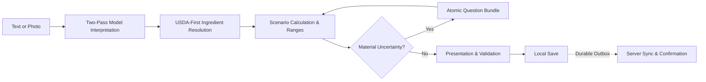

# Calorify

Calorify is an offline-first nutrition tracker for Android and Wear OS. Log meals via text description or photo, receive reliable calorie and macro estimates grounded in USDA data, and track daily goals across devices.

> **Disclaimer**: Calorie estimates are for informational purposes only and do not constitute medical advice.

## Highlights

- **AI-Assisted Meal Logging**: Two-pass structured interpretation from natural language or camera photos.
- **USDA-Grounded Estimates**: Deterministic calculation using verified USDA food records with explicit fallback boundaries.
- **Smart Clarification**: Asks targeted questions only when uncertainty materially affects nutrition totals.
- **Offline-First & Durable Sync**: Local SQLite storage via Drift with an outbox pattern for backend confirmation and Health Connect export.
- **Wear OS Companion**: Compact smartwatch app with voice-first logging and peer synchronization.

## Architecture & Analysis Pipeline



### Core Principles

- **Two Model Passes**: Component detection and ingredient decomposition stay small, structured, and validated independently.
- **USDA Grounding**: Reference foods provide authoritative nutrient baselines; deterministic arithmetic calculates totals.
- **Scenarios Before Questions**: Explores plausible recipe scenarios and ranges first; asks only when answers materially narrow uncertainty.
- **Offline Reliability**: Saves immediately to the local device database, queuing sync operations for when connectivity is restored.

For deep architectural design and roadmap, see the [V3 Architecture Plan](docs/plans/meal-analysis-reliability.md).

## Repository Layout

- [`app/calorify/`](app/calorify/README.md) — Primary Flutter mobile application for Android.
- [`app/watch/`](app/watch/README.md) — Companion Wear OS application.
- [`app/shared_packages/`](app/shared_packages/README.md) — Shared Dart models, protobufs, design tokens, and utilities.
- [`backend/`](backend/README.md) — Fastify/TypeScript backend, nutrition engine, and USDA database.

## Getting Started

Prerequisites: Flutter SDK, Node.js (v22+), and Docker.

```bash
# Clone the repository
git clone <repository-url>
cd calorify

# Install dependencies
cd app/calorify && flutter pub get
cd ../watch && flutter pub get
cd ../../backend && npm ci
cp env.example .env
```

Configure `backend/.env` with local settings and follow the [Backend Setup Guide](backend/README.md). Run either app from its directory using `flutter run`.

## Documentation

- [Documentation Index](docs/README.md) — Complete index of all guides, architecture plans, and runbooks.
- [Phone App Guide](app/calorify/README.md) — Testing, coverage, and development workflow.
- [Wear OS Guide](app/watch/README.md) — Watch development and Data Layer synchronization.
- [Backend Guide](backend/README.md) — API services, USDA bootstrap, and local test runners.
- [Deployment Runbook](backend/DEPLOYMENT.md) — Staging, production, and cloud operations.
- [Security Policy](SECURITY.md) — Secret handling and vulnerability disclosure.

## Contributing

Contributions and bug fixes are welcome. Please ensure credentials are never committed, adhere to existing architectural invariants, and add test coverage for behavioral changes.
