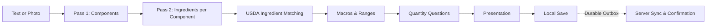

# Calorify

Calorify is an offline-first nutrition tracker for Android and Wear OS. Log meals via text description or photo, receive reliable calorie and macro estimates grounded in USDA data, and track daily goals across devices.

> **Disclaimer**: Calorie estimates are for informational purposes only and do not constitute medical advice.

## Highlights

- **AI-Assisted Meal Logging**: Two-pass structured interpretation from natural language or camera photos.
- **USDA-Grounded Estimates**: Deterministic calculation from USDA food records matched to each ingredient.
- **Smart Clarification**: Generates quantity questions only when uncertainty materially affects calorie totals (answers are not handled yet).
- **Offline-First & Durable Sync**: Local SQLite storage via Drift with an outbox pattern for backend confirmation and Health Connect export.
- **Wear OS Companion**: Compact smartwatch app with voice-first logging and peer synchronization.

## Architecture & Analysis Pipeline



### Core Principles

- **Two Model Passes**: Component detection and ingredient decomposition stay small, structured, and validated independently. Pass 2 runs once per component, in parallel.
- **USDA Grounding**: Reference foods provide authoritative nutrient baselines; deterministic arithmetic calculates totals.
- **Ranges Before Questions**: Every portion carries a minimum and maximum; a question is generated only when a calorie range is wide enough to matter.
- **Offline Reliability**: Saves immediately to the local device database, queuing sync operations for when connectivity is restored.

For the current backend pipeline architecture, see the [Meal-Analysis Pipeline doc](backend/docs/meal-analysis-pipeline.md); for active backend work, see the [backend roadmap](backend/TODO.md).

## Repository Layout

- [`app/calorify/`](app/calorify/README.md) — Primary Flutter mobile application for Android.
- [`app/watch/`](app/watch/README.md) — Companion Wear OS application.
- [`app/shared_packages/`](app/shared_packages/README.md) — Shared Dart models, protobufs, design tokens, and utilities.
- [`backend/`](backend/README.md) — Go API service, meal-analysis pipeline, and USDA reference database.

## Getting Started

Prerequisites: Flutter SDK, Go (1.27+), and Docker.

```bash
# Clone the repository
git clone <repository-url>
cd calorify

# Install dependencies
cd app/calorify && flutter pub get
cd ../watch && flutter pub get
cd ../../backend && go mod download
```

Follow the [Backend Setup Guide](backend/README.md) to start the databases, load the USDA data and run the server. Run either app from its directory using `flutter run`.

## Documentation

- [Documentation Index](docs/README.md) — Complete index of all guides, architecture plans, and runbooks.
- [Phone App Guide](app/calorify/README.md) — Testing, coverage, and development workflow.
- [Wear OS Guide](app/watch/README.md) — Watch development and Data Layer synchronization.
- [Backend Guide](backend/README.md) — API service, USDA setup, and local runners.
- [Deployment Runbook](backend/docs/DEPLOYMENT.md) — Production topology, configuration, and migrations.

## Contributing

Contributions and bug fixes are welcome. Never commit credentials — use ignored env files or GitHub environment secrets, and run `./scripts/check-secrets.sh` before pushing. If a credential reaches Git, revoke and rotate it at the provider first, then clean the history. Adhere to existing architectural invariants, and add test coverage for behavioral changes.
